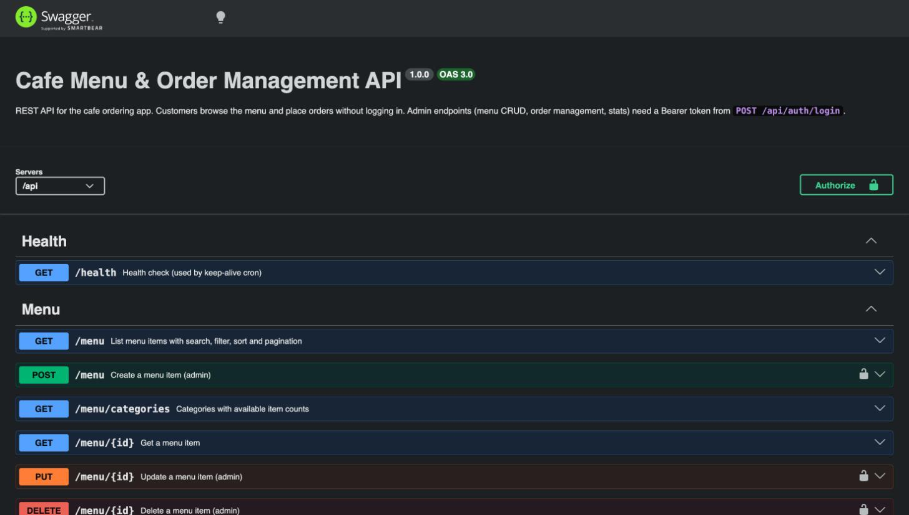

# Brew & Bite — Cafe Ordering (Backend API)

Node.js, Express and MongoDB REST API for a MERN cafe ordering system. It covers menu management, ordering without login, order tracking with live status over Socket.io, admin auth (JWT) and sales stats from aggregation pipelines. Swagger docs are at **`/api/docs`**.

> Free Render instance: the first request after it has been idle can take up to a minute.
>
> **Frontend (React):** [anildeveloper26/cafe-order-web](https://github.com/anildeveloper26/cafe-order-web)

| | Link |
|---|---|
| **Live API (Render)** | https://cafe-order-api-xxed.onrender.com/api |
| **Swagger docs** | https://cafe-order-api-xxed.onrender.com/api/docs |
| **Live app (Vercel)** | https://cafe-order-web.vercel.app |

## Features

- REST API with full CRUD for menu items, plus endpoints to place and retrieve customer orders.
- **Swagger / OpenAPI** docs at `/api/docs`. The raw spec is at `/api/docs.json`.
- **Zod** validation on body, query and params. One error handler returns `{ success, message, errors[] }` with status codes 400/401/404/409/429/500.
- **Server-side pricing:** order totals are always calculated from database prices. Client-sent prices or totals are ignored. Duplicate lines are merged, and unavailable or deleted items are rejected.
- **Admin auth** with JWT and bcrypt. Customers order without logging in.
- **Socket.io:** `order:new` goes to admins and `order:status` goes to the customer tracking that order.
- **Aggregation pipelines** for dashboard stats (`$facet`: totals, revenue by day, orders by status, top items) and category counts.
- **Indexes:** text index on name and description, `{category, price}`, `{customer.phone, createdAt}`, `{status, createdAt}`.
- Security: helmet, CORS allow-list, JSON body limit, and rate limits on ordering and login.
- **Keep-alive cron jobs** keep the Render free instance awake.

## Tech stack

Node.js 20 · Express 4 · TypeScript · MongoDB Atlas · Mongoose 8 · Zod · Swagger UI · Socket.io · JWT · bcrypt · node-cron · Playwright (E2E) · Docker

## Project structure

```
src/
├── config/        # env, MongoDB connection, CORS
├── constants/     # categories, sorts, order statuses, limits, HTTP codes
├── models/        # Mongoose schemas: MenuItem, Order, Admin
├── validators/    # Zod request schemas (body / query / params)
├── routes/        # route definitions only: path + middleware + controller
├── controllers/   # thin: read request → call service → send response
├── services/      # business logic + all DB queries and aggregations
├── middleware/    # validate, auth (JWT), rate limits, error handler
├── utils/         # queryBuilder, pagination, apiResponse, ApiError, asyncHandler
├── socket/        # Socket.io rooms and events
├── jobs/          # keep-alive cron
├── docs/          # OpenAPI spec
├── seed/          # sample menu (22 items) + admin user
├── app.ts
└── server.ts
e2e/               # Playwright end-to-end tests (API + browser)
```

## API

| Method | Endpoint | Auth | Description |
|---|---|---|---|
| GET | `/api/health` | – | Health check (keep-alive target) |
| GET | `/api/menu?search=&category=&sort=name\|price_asc\|price_desc\|newest&available=&page=&limit=` | – | List menu items |
| GET | `/api/menu/categories` | – | Categories with item counts |
| GET | `/api/menu/:id` | – | Get one item |
| POST | `/api/menu` | Admin | Create item |
| PUT | `/api/menu/:id` | Admin | Update item |
| DELETE | `/api/menu/:id` | Admin | Delete item |
| POST | `/api/orders` | – | Place an order (rate limited) |
| GET | `/api/orders?phone=&status=&page=&limit=` | – / Admin | Customer's orders by phone; admins can list all |
| GET | `/api/orders/:id` | – | Get one order |
| PATCH | `/api/orders/:id/status` | Admin | Update status (pending, preparing, ready, completed, cancelled) |
| GET | `/api/orders/stats` | Admin | Dashboard stats |
| POST | `/api/auth/login` | – | Admin login, returns JWT |

**Place an order**

```http
POST /api/orders
Content-Type: application/json

{
  "customer": { "name": "Priya", "phone": "9876543210", "notes": "Less sugar" },
  "tableNumber": 4,
  "items": [
    { "menuItem": "<menuItemId>", "quantity": 2 },
    { "menuItem": "<menuItemId>", "quantity": 1 }
  ]
}
```

**Error format**

```json
{
  "success": false,
  "message": "Validation failed",
  "errors": [{ "field": "customer.phone", "message": "Enter a valid 10-digit mobile number" }]
}
```

## Data models

- **MenuItem:** `name`, `description`, `category` (coffee | tea | beverages | snacks | meals | desserts), `price`, `imageUrl`, `isAvailable`, `isVeg`, timestamps.
- **Order:** `orderNumber` (e.g. `ORD-7K2M9Q`), `customer { name, phone, notes }`, `tableNumber`, `items[{ menuItem, name, price, quantity, subtotal }]` (a snapshot taken at order time), `totalAmount`, `status`, timestamps.
- **Admin:** `email`, `passwordHash`.

## Getting started

Prerequisites: Node.js 20+ and a MongoDB Atlas connection string (or a local MongoDB).

```bash
git clone https://github.com/anildeveloper26/cafe-order-api.git
cd cafe-order-api
cp .env.example .env        # fill in MONGODB_URI, JWT_SECRET, ADMIN_EMAIL, ADMIN_PASSWORD
npm install
npm run seed                # 22 sample menu items + the admin user (use -- --reset to replace the menu)
npm run dev                 # http://localhost:5000  (docs: http://localhost:5000/api/docs)
```

> **macOS note:** port 5000 is used by AirPlay Receiver. Set `PORT=5001` in `.env` and point the frontend at it.

### Docker (whole app, one command)

```bash
docker compose up --build
```

This starts MongoDB, the API (it seeds itself on first start) and the web app, which is built from the [frontend repo](https://github.com/anildeveloper26/cafe-order-web). Set `WEB_CONTEXT=../cafe-order-web` to build from a local clone instead.

- Web: http://localhost:5173
- API: http://localhost:5000/api
- Docs: http://localhost:5000/api/docs
- Admin login: `admin@cafe.local` / `admin123`

## Environment variables

| Variable | Description |
|---|---|
| `PORT` | API port (default `5000`) |
| `NODE_ENV` | `development` / `production` |
| `MONGODB_URI` | MongoDB Atlas connection string |
| `CORS_ORIGIN` | Comma-separated allowed origins, e.g. `https://your-app.vercel.app` |
| `JWT_SECRET` / `JWT_EXPIRES_IN` | Admin token signing secret / lifetime (default `1d`) |
| `ADMIN_EMAIL` / `ADMIN_PASSWORD` | Admin account created by `npm run seed` |
| `ORDER_RATE_LIMIT` / `LOGIN_RATE_LIMIT` | Optional. Requests per IP per window (defaults 20 per 10 min / 10 per 15 min) |
| `KEEP_ALIVE_URL` | Optional. URL for the keep-alive cron to ping. On Render, `RENDER_EXTERNAL_URL` is used automatically |

## Deployment

**MongoDB Atlas:** create a free cluster and a database user, allow network access from `0.0.0.0/0`, and copy the connection string into `MONGODB_URI`.

**Render:**
1. Create a **New → Web Service**, or use **Blueprint** with `render.yaml`.
2. Build command: `npm ci --include=dev && npm run build`. Start command: `npm start`.
3. Set `MONGODB_URI`, `JWT_SECRET`, `CORS_ORIGIN` (your Vercel URL), `ADMIN_EMAIL`, `ADMIN_PASSWORD` and `NODE_ENV=production`.
4. Seed once from the Render Shell: `npm run seed:prod`.

**Keep-alive cron (Render free tier):** free instances sleep after about 15 minutes without traffic. Two jobs keep the API awake:
1. `src/jobs/keepAlive.ts` uses `node-cron` to ping `/api/health` every 10 minutes, using `RENDER_EXTERNAL_URL`.
2. `.github/workflows/keep-alive.yml` does the same from GitHub Actions. Set the repository variable `BACKEND_URL` to your Render URL.

## Testing

End-to-end tests use [Playwright](https://playwright.dev). Each run starts its own **in-memory MongoDB**, seeds it, and starts the API (port 5055) and the [frontend](https://github.com/anildeveloper26/cafe-order-web) (port 5175). Your real data is never touched.

```bash
./run-e2e.sh                         # everything (clones the frontend next to this repo if missing)
./run-e2e.sh --project=api           # 35 API tests
./run-e2e.sh --project=ui --headed   # 24 browser tests, visible
cd e2e && npm run report             # HTML report with traces, screenshots and video on failure
```

| Suite | Covers |
|---|---|
| `tests/api/health-docs` | health check, Swagger UI, OpenAPI paths, JSON 404, malformed JSON |
| `tests/api/menu` | list, partial search, category filter, sorting, pagination, categories, bad params, 404s, admin-only writes, create → update → delete, validation |
| `tests/api/orders` | server-side pricing, duplicate-line merge, validation, unavailable/missing items, lookup by phone, admin listing, status rules, stats (cancelled orders excluded) |
| `tests/api/auth` | JWT login, case-insensitive email, wrong password, malformed body, invalid tokens |
| `tests/ui/*` | QR welcome pop-up, URL-persisted filters, cart and checkout, live order tracking, admin login redirect, menu CRUD, live orders board, QR page, 404 |

### Testing the live deployment

`./run-prod-e2e.sh` runs a separate Playwright suite (22 tests) against the **deployed** app, by default https://cafe-order-web.vercel.app and this Render API. It catches deployment problems the local suite can't, such as CORS, wrong `VITE_*` env, SPA rewrites, cold starts and Socket.io connectivity.

```bash
./run-prod-e2e.sh --read-only        # 14 checks, never writes to production
./run-prod-e2e.sh                    # full flow: also places test orders + admin CRUD, then cleans up
cd e2e && npm run report:prod        # HTML report
```

- **Read-only checks:**
  - health and DB connection, Swagger docs
  - menu search, filter and sort; error responses; CORS allow and block; Socket.io handshake; security headers
  - QR pop-up, URL-persisted filters, deep links and 404
  - API URL baked into the build, cart totals, checkout validation, no console errors
- **Full flow (`@write`):**
  - admin login
  - menu item and order lifecycle with server-side pricing
  - a customer orders in the browser and sees status changes live
  - "My orders" lookup
  - admin dashboard and orders board
  - menu create → visible to customers → hide → delete
- **Config:** set `PROD_ADMIN_EMAIL` / `PROD_ADMIN_PASSWORD` (required for the full flow) and optionally `PROD_WEB_URL` / `PROD_API_URL`, either in your shell or in `e2e/.env.prod` (git-ignored; see `e2e/.env.prod.example`).
- **Test data:**
  - Orders use the customer name `E2E Smoke Test` and phone `9000000000`. Menu items are named `[E2E] …`.
  - After every run, and again before the next one, all test orders are set to `cancelled` (excluded from revenue) and all `[E2E]` items are deleted.
  - Real customer orders are never touched.
- **Logins:** a run logs in about 3 times. The API allows 10 logins per 15 minutes per IP, so don't run it more than about 3 times in a row.
- **CI:** `.github/workflows/prod-e2e.yml` runs daily and on demand (Actions → Live deployment E2E → Run workflow, with an optional read-only toggle). Add the repository secrets `PROD_ADMIN_EMAIL` and `PROD_ADMIN_PASSWORD`.

CI (`.github/workflows/ci.yml`) type-checks and builds on every push, then runs the full E2E suite against the latest frontend. If it fails, the report is uploaded as an artifact.

## Scripts

| Command | What it does |
|---|---|
| `npm run dev` | Start API with hot reload |
| `npm run build` / `npm start` | Compile TypeScript / run the compiled server |
| `npm run seed` / `npm run seed:prod` | Seed menu + admin (dev / compiled) |
| `npm run typecheck` | Type-check |
| `./run-e2e.sh` | End-to-end tests (local, in-memory DB) |
| `./run-prod-e2e.sh [--read-only]` | End-to-end tests against the live deployment |

## Screenshots

**Swagger API docs**



The app screenshots are in the [frontend README](https://github.com/anildeveloper26/cafe-order-web#screenshots).
